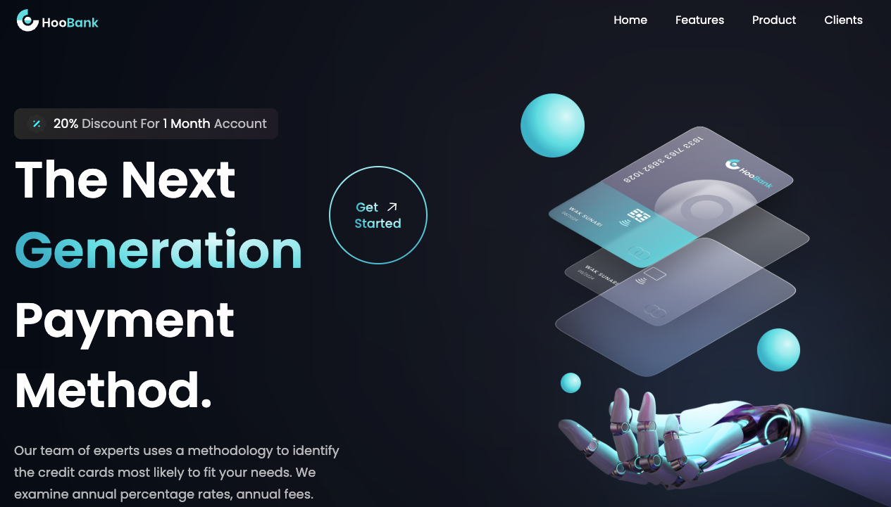

# 💳 HooBank – Fintech Landing Page

A modern, fully responsive landing page built with React, Vite and Tailwind CSS, inspired by professional UI/UX standards. It features a smooth interface, elegant gradients and a clean structure based on reusable, modular components.

🔗 **Live demo: [https://yelle-stack.github.io/bankApp/](https://yelle-stack.github.io/bankApp/)**



## ✨ Sections

- **Navbar**: responsive navigation with an animated mobile menu.
- **Hero**: modern introduction with a "Get Started" call to action, dynamic gradients and a 3D robot visual.
- **Stats**: key figures displayed in responsive blocks.
- **Business**: main features presented as feature cards.
- **Billing**: billing and invoicing service with App Store / Google Play badges.
- **Card Deal**: card offers and comparisons with a call to action.
- **Testimonials**: user feedback displayed in styled cards.
- **Clients**: partner logos in a responsive grid.
- **CTA**: a central block inviting visitors to try the service.
- **Footer**: useful links, categories, social media and legal information.

## 🚀 Tech Stack

- **React**: hooks and modular components
- **Vite**: fast build tool
- **Tailwind CSS**: centralized design system
- **Custom CSS utilities**: gradients, animations, shadows
- **Responsive design**: optimized for mobile and desktop

## 🛠️ Getting Started

```bash
git clone https://github.com/Yelle-stack/bankApp.git
cd bankApp
npm install
npm run dev
```

Then open `http://localhost:3000/` in your browser.

## 🌐 Deployment

The site is deployed on GitHub Pages:

```bash
npm run deploy
```

## 🎯 Project Goal

To provide a professional, ready-to-use UI for a fintech, SaaS or digital service. The code is designed to be easy to reuse, maintain and adapt to other projects.
